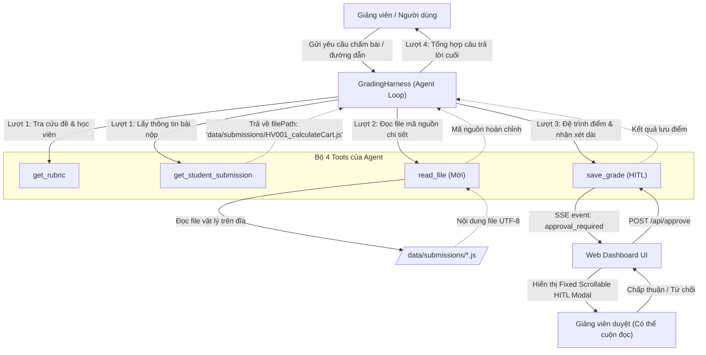

# Thiết Kế Chi Tiết: Công Cụ Đọc File (read_file Tool), Hỗ Trợ Đường Dẫn Bài Nộp (filePath) & Khắc Phục Lỗi Cuộn Màn Hình (UI Scroll Fix)

**Ngày lập**: 2026-11-09  
**Dự án**: BT Harness - Student Grading Agent Harness  
**Tác giả**: Antigravity & Tech Lead  
**Trạng thái**: Approved by User  

---

## 1. Bối cảnh & Mục tiêu (Context & Objectives)

### 1.1. Hiện trạng
- Hệ thống **Student Grading Agent Harness** hiện tại sở hữu 3 công cụ tự hành cốt lõi:
  1. `get_rubric`: Tra cứu barem tiêu chí bài tập.
  2. `get_student_submission`: Lấy mã nguồn bài nộp của học viên từ file JSON dữ liệu (`data/students.json`).
  3. `save_grade`: Ghi nhận điểm số và kích hoạt cơ chế Human-in-the-loop (HITL) phê duyệt.
- Dữ liệu bài nộp hiện tại lưu trực tiếp dưới dạng chuỗi `submissionCode` nhúng cứng trong `data/students.json`. Chưa hỗ trợ đọc từ file vật lý trên đĩa hoặc từ đường dẫn do người dùng/học viên cung cấp.
- Trên giao diện Web Dashboard (`public/index.html`): Cửa sổ duyệt điểm của giảng viên (`#hitlModal`) đang sử dụng định vị `absolute bottom-24`. Khi Agent đưa ra phản hồi và nhận xét chi tiết quá dài (hàng trăm dòng gồm phân tích tiêu chí, mã minh họa, lời khuyên), modal bị tràn ra ngoài khung nhìn của trình duyệt (viewport overflow) và không thể cuộn xem hết nội dung, che khuất hoặc làm mất các nút phê duyệt.

### 1.2. Mục tiêu kỹ thuật
1. **Phát triển Tool `read_file` độc lập**: Cho phép AI Agent tự hành đọc nội dung file bất kỳ trong phạm vi an toàn của workspace (mã nguồn, file test case, tài liệu tham khảo, v.v.) qua đường dẫn.
2. **Nâng cấp mô hình dữ liệu bài nộp**: Bổ sung trường `filePath` trong `StudentSubmission` và chuẩn hóa thư mục `data/submissions/` chứa mã nguồn thực tế của học viên.
3. **Mở rộng Agent Loop thành hệ thống 4 Tools**: Bổ sung `read_file` vào vòng lặp của Harness, cập nhật System Prompt hướng dẫn Agent chủ động sử dụng tool khi gặp đường dẫn file.
4. **Khắc phục triệt để lỗi tràn giao diện (UI Scroll Overflow)**:
   - Tái cấu trúc `#hitlModal` thành dạng fixed modal overlay có thanh cuộn riêng (`overflow-y-auto`, `max-h-[85vh]`).
   - Cố định phần Header và Footer của Modal để thông tin điểm số và nút bấm Duyệt / Từ chối luôn hiển thị rõ ràng.
   - Tối ưu khung chat `#chatContainer` đảm bảo cuộn mượt mà, không bị ngắt quãng.

---

## 2. Thiết Kế Kiến Trúc & Luồng Dữ Liệu (Architecture & Data Flow)

### 2.1. Sơ đồ luồng tương tác 4 Tools



---

## 3. Đặc Tả Chi Tiết Các Thành Phần

### 3.1. Tool `read_file` (`src/tools/read-file.ts`)
- **Tên Tool**: `read_file`
- **Mục đích**: Đọc nội dung file văn bản từ đường dẫn tương đối (hoặc tuyệt đối nằm trong workspace dự án).
- **Tham số đầu vào (Zod Schema)**:
  ```typescript
  export const readFileSchema = z.object({
    path: z.string().describe('Đường dẫn tương đối (ví dụ: data/submissions/HV001_calculateCart.js) hoặc tuyệt đối tới file cần đọc trong dự án')
  });
  ```
- **Quy tắc bảo mật & ràng buộc an toàn**:
  1. *Chống Path Traversal*:
     ```typescript
     const rootDir = process.cwd();
     const resolvedPath = path.resolve(rootDir, inputPath);
     if (!resolvedPath.startsWith(rootDir)) {
       return { isError: true, message: 'Từ chối truy cập: Đường dẫn nằm ngoài thư mục dự án cho phép.' };
     }
     ```
  2. *Kiểm tra tồn tại*: Sử dụng `fs.stat` để xác nhận file tồn tại và không phải là thư mục.
  3. *Giới hạn kích thước file*: Giới hạn tối đa `200KB` (`204,800 bytes`). Nếu vượt quá, trả về thông báo lỗi yêu cầu chia nhỏ file để tránh tràn LLM context.
  4. *Định dạng file cho phép*: Hỗ trợ các file text mã nguồn và dữ liệu: `.js`, `.ts`, `.json`, `.txt`, `.md`, `.csv`, `.html`, `.css`. Từ chối các file nhị phân (`.exe`, `.bin`, `.png`, `.jpg`, `.zip`).
- **Dữ liệu đầu ra (Success payload)**:
  ```typescript
  {
    isError: false,
    path: string,
    fileName: string,
    extension: string,
    sizeBytes: number,
    lineCount: number,
    content: string
  }
  ```

### 3.2. Cấu Trúc Dữ Liệu & Thư Mục Bài Nộp
1. **Cập nhật Interface `StudentSubmission`** trong `src/types.ts`:
   ```typescript
   export interface StudentSubmission {
     studentId: string;
     fullName: string;
     assignmentId: string;
     status: 'pending' | 'graded';
     submissionCode: string;
     filePath?: string; // Đường dẫn tương đối tới file thực tế trên đĩa
   }
   ```
2. **Khởi tạo thư mục và file bài nộp thực tế**:
   - `data/submissions/HV001_calculateCart.js`: Mã nguồn bài làm của học viên Nguyễn Văn An (tính đúng subtotal, VAT, có voucher SALE10, thiếu VIP20).
   - `data/submissions/HV002_calculateCart.js`: Mã nguồn bài làm của học viên Trần Thị Bình (clean code xuất sắc, xử lý cả SALE10 và VIP20, có kiểm tra ngoại lệ).
   - `data/submissions/HV003_calculateCart.js`: Mã nguồn bài làm của học viên Lê Văn Cường (thuật toán còn lỗi sai VAT trước chiết khấu, thiếu kiểm tra mảng).
3. **Cập nhật `data/students.json`**:
   Bổ sung trường `"filePath": "data/submissions/HV001_calculateCart.js"`, v.v. vào từng bản ghi học viên.
4. **Nâng cấp `src/tools/get-submission.ts`**:
   - Nếu bản ghi học viên có `filePath`, tự động đọc nội dung file vào `submissionCode` nếu chuỗi `submissionCode` ban đầu rỗng.
   - Luôn trả về thuộc tính `filePath` trong object học viên để Agent nắm bắt được vị trí file thực tế.

### 3.3. Tích Hợp Agent Harness Loop & System Prompt
1. **Đăng ký tool trong `src/tools/index.ts`**:
   ```typescript
   export function createGradingTools(approvalHandler: ApprovalHandler) {
     return {
       get_rubric: getRubricTool,
       get_student_submission: getSubmissionTool,
       read_file: readFileTool,
       save_grade: createSaveGradeTool(approvalHandler)
     };
   }
   ```
2. **Cập nhật `SYSTEM_INSTRUCTION` trong `src/harness/loop.ts`**:
   - Thêm phần mô tả công cụ `read_file` vào danh sách công cụ được cấp quyền.
   - Hướng dẫn Agent:
     - Khi cần đọc mã nguồn học viên mà bài nộp có `filePath`, hoặc khi người dùng yêu cầu chấm một file mã nguồn cụ thể theo đường dẫn: Hãy gọi `read_file` với tham số `path`.
     - Phân tích mã nguồn thu được từ `read_file` theo 4 tiêu chí barem đã chuẩn hóa (Logic 6đ, Clean code 1đ, Ngoại lệ 2đ, Edge cases 1đ).

---

## 4. Thiết Kế Sửa Lỗi Giao Diện Web (UI Scroll Fix)

### 4.1. Tái cấu trúc `#hitlModal` trong `public/index.html`
- **Hiện tượng lỗi**: Modal được gán class `absolute inset-x-4 bottom-24`, khi `req.feedback` dài, chiều cao vượt quá màn hình khiến nội dung bị đẩy lên trên quá thanh header và không có thanh cuộn, không nhìn thấy nút Duyệt / Từ chối.
- **Giải pháp thiết kế**:
  - Chuyển thành **Fixed Modal Backdrop**:
    ```html
    <div id="hitlModal" class="hidden fixed inset-0 z-50 flex items-center justify-center p-4 bg-slate-950/80 backdrop-blur-sm">
      <div class="bg-slate-900 border-2 border-amber-500/80 rounded-2xl max-w-2xl w-full p-5 shadow-2xl flex flex-col max-h-[85vh]">
        <!-- 1. Header (Sticky) -->
        <div class="flex items-center justify-between pb-3 border-b border-slate-800 shrink-0">
          ...
        </div>

        <!-- 2. Content Body (Scrollable) -->
        <div id="hitlContent" class="flex-1 overflow-y-auto pr-2 my-3 space-y-3 text-sm">
          <!-- Injected via JS with scroll support -->
        </div>

        <!-- 3. Footer Actions (Sticky) -->
        <div class="pt-3 border-t border-slate-800 flex items-center justify-end gap-3 shrink-0">
          <button onclick="submitApproval(false)">Từ chối</button>
          <button onclick="submitApproval(true)">Chấp thuận & Lưu điểm</button>
        </div>
      </div>
    </div>
    ```
- **Hiệu quả**:
  - Dù nhận xét dài 10 trang, vùng nội dung `#hitlContent` tự động sinh thanh cuộn riêng biệt.
  - Người dùng có thể cuộn xem toàn bộ nhận xét từ đầu đến cuối mà không bị trôi mất 2 nút bấm thao tác quan trọng.

### 4.2. Tối ưu khung chat `#chatContainer`
- Bổ sung quy tắc CSS `break-words` và `overflow-x-hidden` để các khối mã nguồn dài trong nhận xét không làm vỡ layout ngang.
- Tinh chỉnh cơ chế cuộn tự động: chỉ tự cuộn xuống đáy khi người dùng đang ở gần đáy (`scrollTop + clientHeight >= scrollHeight - 100`), tránh gián đoạn khi người dùng đang chủ động cuộn lên đọc nội dung phía trên.

---

## 5. Kế Hoạch Kiểm Thử (Testing & Quality Assurance)

### 5.1. Unit Tests (`tests/read-file.test.ts`)
1. **Đọc file thành công**: Đọc đúng file `data/submissions/HV001_calculateCart.js`, kiểm tra trả về `content`, `fileName`, `lineCount` chính xác.
2. **Chặn Path Traversal**: Truyền `../../package.json` hoặc `/windows/system32`, xác nhận tool trả về `isError: true` và thông báo từ chối truy cập.
3. **Xử lý file không tồn tại**: Truyền `data/submissions/non_existent.js`, xác nhận trả về lỗi rõ nghĩa.
4. **Kiểm tra giới hạn dung lượng**: Giả lập file > 200KB, xác nhận bị từ chối an toàn.

### 5.2. Integration & Regression Tests
- Chạy toàn bộ test suites hiện có: `npm test` (đảm bảo 56/56 tests hiện hữu vẫn PASS 100%, cộng thêm các tests mới).
- Chạy kiểm tra kiểu tĩnh: `npm run typecheck` (đảm bảo 0 lỗi TypeScript).

### 5.3. E2E Web Verification
1. Mở giao diện `http://localhost:3000`.
2. Kiểm tra tab danh sách học viên: Có hiển thị thông tin file nộp.
3. Gửi prompt: *"Hãy đọc file data/submissions/HV001_calculateCart.js và chấm điểm chi tiết bài này"*.
4. Quan sát: Lượt 1 Agent gọi `read_file` -> Lượt 2 Agent đọc mã nguồn và đối chiếu barem -> Lượt 3 Agent gọi `save_grade` -> Popup HITL xuất hiện với thanh cuộn mượt mà -> Người dùng duyệt thành công.

---

## 6. Kế Hoạch Triển Khai (Implementation Steps)

1. **Bước 1**: Tạo thư mục `data/submissions/` và trích xuất 3 file bài nộp thực tế cho HV001, HV002, HV003.
2. **Bước 2**: Cập nhật `src/types.ts` bổ sung `filePath?: string`.
3. **Bước 3**: Hiện thực `src/tools/read-file.ts` với đầy đủ cơ chế bảo mật và Zod schema.
4. **Bước 4**: Nâng cấp `src/tools/get-submission.ts` và `src/tools/index.ts` để kết nối `read_file`.
5. **Bước 5**: Cập nhật System Instruction trong `src/harness/loop.ts`.
6. **Bước 6**: Sửa cấu trúc HTML/CSS của `#hitlModal` và `#chatContainer` trong `public/index.html`.
7. **Bước 7**: Viết unit test trong `tests/read-file.test.ts`, chạy `npm test` và `npm run typecheck`.
8. **Bước 8**: Chạy web server và kiểm thử giao diện thực tế.
