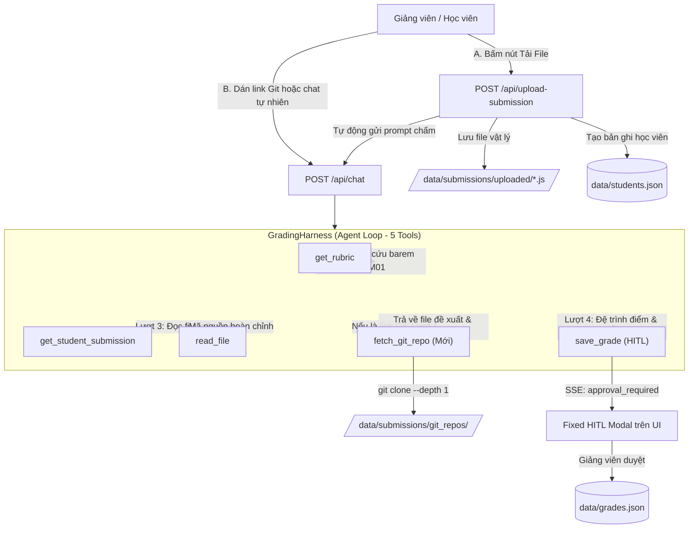

# Thiết Kế Chi Tiết: Nộp Bài Bằng Tải File Trực Tiếp & Link Git Repository (File Upload & Git Repo Grading)

**Ngày lập**: 2026-11-09  
**Dự án**: BT Harness - Student Grading Agent Harness  
**Tác giả**: Antigravity & Tech Lead  
**Trạng thái**: Approved by User  

---

## 1. Bối cảnh & Mục tiêu (Context & Objectives)

### 1.1. Hiện trạng
- Hệ thống Agent Harness đã hỗ trợ 4 tools: `get_rubric`, `get_student_submission`, `read_file`, `save_grade`.
- Học viên hiện tại được quản lý trong file `data/students.json` với các file mã nguồn mẫu trong `data/submissions/*.js`.
- Tuy nhiên, trong thực tế giảng dạy và chấm thi, giảng viên cần chấm bài nộp mới phát sinh từ học sinh theo 2 phương thức:
  1. **Tải file bài làm lên (File Upload)**: Học viên/Giảng viên gửi trực tiếp file mã nguồn `.js` hoặc `.ts` từ máy tính cá nhân.
  2. **Gửi link Git repository (Git Repo Link)**: Học sinh nộp bài qua đường dẫn kho chứa mã nguồn GitHub/GitLab.

### 1.2. Mục tiêu kỹ thuật
1. **Phát triển Tool `fetch_git_repo`**: Cho phép Agent tự động clone nông (`git clone --depth 1`) repo từ đường dẫn HTTPS an toàn, quét tìm file bài làm (`calculateCart.js`, `index.js`, v.v.) và trả về đường dẫn để Agent kết hợp với `read_file` đọc và chấm điểm.
2. **Xây dựng API Upload bài làm (`POST /api/upload-submission`)**: Tiếp nhận file mã nguồn tải lên từ trình duyệt, lưu vào thư mục `data/submissions/uploaded/` và tự động tạo bản ghi học viên mới để đưa vào quy trình chấm.
3. **Mở rộng hệ thống thành 5 Tools hoàn chỉnh**: `get_rubric`, `get_student_submission`, `read_file`, `fetch_git_repo`, `save_grade`.
4. **Nâng cấp Web Dashboard UI**:
   - Thêm nút bấm **📎 Tải file bài làm** cạnh ô nhập chat.
   - Thêm nút bấm **🔗 Chấm Git Repo** mở popover nhập nhanh URL.
   - Hỗ trợ Agent tự động phát hiện link Git trong tin nhắn chat thông thường.
   - Hiển thị nguồn gốc bài nộp (`File Upload` / `Git Repo`) trên danh sách học viên và bảng điểm.

---

## 2. Kiến Trúc & Luồng Tương Tác 5 Tools



---

## 3. Đặc Tả Chi Tiết Các Thành Phần

### 3.1. Tool `fetch_git_repo` (`src/tools/fetch-git.ts`)
- **Tên Tool**: `fetch_git_repo`
- **Mục đích**: Tải mã nguồn từ kho chứa Git công khai về thư mục cách ly để chấm bài.
- **Tham số đầu vào (Zod Schema)**:
  ```typescript
  export const fetchGitSchema = z.object({
    repoUrl: z.string().describe('URL HTTPS của Git repository (ví dụ: https://github.com/student/asm01-cart)')
  });
  ```
- **Ràng buộc an toàn & Chống Command Injection**:
  1. *Kiểm tra Regex URL nghiêm ngặt*:
     ```typescript
     const GIT_URL_REGEX = /^https:\/\/(github\.com|gitlab\.com|bitbucket\.org)\/([a-zA-Z0-9_.-]+)\/([a-zA-Z0-9_.-]+?)(\.git)?(\/)?$/;
     ```
     Từ chối các URL có dấu cách, ký tự đặc biệt shell (`;`, `&`, `|`, `` ` ``, `$`).
  2. *Thực thi lệnh an toàn*:
     Sử dụng `child_process.execFile` với mảng đối số:
     ```typescript
     execFile('git', ['clone', '--depth', '1', '--single-branch', repoUrl, targetDir], { timeout: 30000 });
     ```
  3. *Thư mục đích*:
     `data/submissions/git_repos/<timestamp>_<repo_name>` nằm trọn trong thư mục dự án, được tự động đưa vào `.gitignore`.
  4. *Quét tìm file mã nguồn bài nộp*:
     Duyệt cây thư mục đã clone, tìm các file ứng viên: `calculateCart.js`, `calculateCart.ts`, `index.js`, `cart.js`, `main.js`.
- **Payload trả về (Success)**:
  ```typescript
  {
    isError: false,
    repoName: string,
    cloneDir: string,
    candidateFiles: string[],
    recommendedFile: string,
    message: string
  }
  ```

### 3.2. Endpoint Upload File (`POST /api/upload-submission`)
- **Route**: `POST /api/upload-submission`
- **Xử lý Multipart Form Data**:
  - Hỗ trợ tải file thông qua stream parser (hoặc busboy/multer tối giản) không phụ thuộc external binary.
  - Giới hạn dung lượng: Tối đa 200KB (đồng bộ với giới hạn của `read_file`).
  - Đuôi file cho phép: `.js`, `.ts`.
- **Lưu trữ & Tích hợp**:
  - File được lưu tại: `data/submissions/uploaded/<timestamp>_<clean_name>.js`.
  - Tự động sinh bản ghi học viên mới trong `data/students.json`:
    - `studentId`: `HV_UP_<4 ký tự ngẫu nhiên>`
    - `fullName`: Lấy từ tên file (ví dụ: `NguyenVanA_calculateCart` -> `Nguyễn Văn A` hoặc tên file gốc).
    - `assignmentId`: `ASM01`.
    - `status`: `pending`.
    - `filePath`: Đường dẫn tương đối từ gốc dự án tới file vừa lưu.
    - `submissionCode`: Nội dung file vừa tải lên.
- **Payload trả về**:
  ```typescript
  {
    success: true,
    studentId: string,
    fullName: string,
    filePath: string,
    message: string
  }
  ```

### 3.3. Tích Hợp Hệ Thống 5 Tools & System Prompt
1. **Xuất bản trong `src/tools/index.ts`**:
   ```typescript
   export function createGradingTools(approvalHandler: ApprovalHandler) {
     return {
       get_rubric: getRubricTool,
       get_student_submission: getSubmissionTool,
       read_file: readFileTool,
       fetch_git_repo: fetchGitRepoTool,
       save_grade: createSaveGradeTool(approvalHandler)
     };
   }
   ```
2. **Cập nhật `SYSTEM_INSTRUCTION` trong `src/harness/loop.ts`**:
   - Thêm mô tả tool `fetch_git_repo`.
   - Hướng dẫn Agent quy trình: Khi người dùng cung cấp link Git, Agent gọi `fetch_git_repo` để lấy mã nguồn, sau đó gọi `read_file` với file đề xuất, đối chiếu barem ASM01 và đệ trình `save_grade`.

### 3.4. Giao Diện Web Dashboard (`public/index.html`)
1. **Nút "📎 Tải bài làm"**:
   - Nằm ngay bên trái ô nhập tin nhắn `#messageInput`.
   - Ẩn thẻ `<input type="file" id="submissionFileInput" accept=".js,.ts">`.
   - Khi người dùng chọn file -> gọi `uploadSubmissionFile()` -> hiển thị toast thành công -> tự động chèn tin nhắn và gửi vào chat:  
     `"Tôi vừa nộp file bài làm <tên_file>. Hãy đọc mã nguồn và chấm điểm theo barem ASM01 giúp tôi."`
2. **Nút "🔗 Chấm Git Repo"**:
   - Nằm cạnh nút Tải bài làm, mở popover nhỏ với input URL và nút "Bắt đầu chấm".
   - Khi bấm, tự động chèn câu lệnh chat:  
     `"Hãy tải mã nguồn từ repo <git_url> và chấm điểm bài tập ASM01 này."`
3. **Danh Sách Học Viên & Bảng Điểm**:
   - Thêm badge nhận diện trực quan:
     - `Git Repo` (màu tím kèm icon Git).
     - `Tải lên` (màu xanh lục kèm icon upload).
     - `Hệ thống` (màu chàm mặc định).

---

## 4. Kế Hoạch Kiểm Thử (Testing Plan)

### 4.1. Unit Tests
1. **`tests/fetch-git.test.ts`**:
   - Kiểm tra validation URL: chấp nhận các URL GitHub/GitLab hợp lệ, từ chối URL có command injection (chứa dấu cách, `;`, `&`, `|`).
   - Mocking / Isolated test: Kiểm tra xử lý lỗi khi URL repo không tồn tại (404/không clone được).
2. **`tests/upload.test.ts`**:
   - Kiểm tra hàm lưu file bài nộp tải lên và tự động tạo học viên `HV_UP_...` hợp lệ.

### 4.2. Regression & Static Check
- `npm test`: Đảm bảo toàn bộ 67 tests cũ + tests mới đều PASS 100%.
- `npm run typecheck`: Đảm bảo 0 lỗi TypeScript.

---

## 5. Kế Hoạch Triển Khai (Implementation Steps)

1. **Task 1**: Hiện thực Tool `src/tools/fetch-git.ts` kèm unit tests trong `tests/fetch-git.test.ts`.
2. **Task 2**: Hiện thực endpoint `POST /api/upload-submission` trong `src/server.ts` và logic tạo học viên mới.
3. **Task 3**: Nâng cấp `src/tools/index.ts` xuất bản 5 tools và cập nhật `SYSTEM_INSTRUCTION` trong `src/harness/loop.ts`.
4. **Task 4**: Cập nhật Web UI trong `public/index.html` (thêm nút 📎 Tải bài làm, nút 🔗 Git repo, gắn badge nguồn gốc học viên).
5. **Task 5**: Kiểm thử toàn diện E2E và nghiệm thu.
